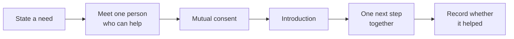

# Tulay

**"Your next career move shouldn't be a solo mission."**

*People. Opportunities. Progress.*


Tulay ("bridge" in Filipino) is a community-powered career-mobility platform for
freelancers, career shifters and independent workers, Philippines first. You
state a goal and the specific help you need. Tulay finds people whose skills
complement yours, asks **both** of you before any introduction, helps you agree
on one concrete collaboration, and records whether it helped.

Built for the Meta Global AI Developer Hackathon (Oct 26 – Nov 4, 2026).

## Contents

- [The three pathways](#the-three-pathways)
- [How one journey works](#how-one-journey-works)
- [Career intelligence](#career-intelligence)
- [Try the demo](#try-the-demo)
- [Status and limitations](#status-and-limitations)
- [Roadmap](#roadmap)
- [Docs](#docs)
- [License](#license)

## The three pathways

| Pathway | Who it's for | What happens |
| --- | --- | --- |
| **Change careers** | BPO professionals moving into tech, designers going into product, anyone navigating a transition | Map your current role to target roles, see transferable skills and areas to develop, meet people who made the move |
| **Grow as a freelancer** | Designers, developers, editors, independents trading skills | Pricing and proposal advice, portfolio feedback, skill swaps with people who need what you offer |
| **Build something together** | Aspiring founders and collaborators | Co-founder matching, pitch feedback, early users, domain experts |

All three share one matching engine and one consent lifecycle — not three apps.

## How one journey works



A full pass: pick a path → describe your situation (Muse Spark structures it,
you confirm) → browse complementary people one at a time with reciprocity shown
→ review and send an introduction request → the other person accepts or
declines (simulated and labeled in the demo) → agree on a next step → record
the outcome. Saved collaborations persist in your browser; nothing is sent to
anyone in demo mode.

## Career intelligence

The Change-careers path includes a Landas-inspired career map: 8 curated roles
with real skill relationships (adapted from the Landas catalog), adjacent-role
suggestions with stated reasons, transferable-skill confirmation, and
to-develop ideas presented as possibilities — never as verified gaps. Your
confirmed direction enriches matching (direction keywords plus a
career-relevance reason on each match) through the existing engine. Details in
[`docs/decisions/0002-landas-knowledge-transfer.md`](docs/decisions/0002-landas-knowledge-transfer.md).

## Try the demo

Prerequisites: Node.js 20+ and npm.

```bash
cd apps/web
npm install
npm run dev    # http://localhost:3000
```

Then open http://localhost:3000/demo, or start at the landing page. No sign-up,
no database, no API key needed — without credentials the app runs in labeled
demo mode with 14 fictional members.

<details>
<summary>Environment variables (all optional for the demo)</summary>

See `.env.example` (placeholders only; never commit real values). Without them:
deterministic `DemoProvider` for AI text and synthetic fixtures for people.
Set `AI_PROVIDER=meta` plus `MODEL_API_KEY` in `apps/web/.env.local` for live
Muse Spark calls; `/api/health` reports which provider is active.

</details>

<details>
<summary>Commands and checks</summary>

```bash
npm test            # vitest, from the repo root
npm run lint        # eslint (web workspace)
npm run typecheck   # tsc --noEmit, all workspaces
npm run build       # production build (web workspace)
```

Current results: 146/146 tests, clean lint and typecheck, production build
green. `next build` defaults to Turbopack; if your sandbox blocks its worker
ports, `npx next build --webpack` in `apps/web` is the verified fallback.

</details>

## Status and limitations

Working in this prototype: landing, guided journey with career mapping,
one-at-a-time reciprocal matching, introduction requests, simulated
accept/decline consent, collaboration next steps, outcome recording, and
browser-local persistence with demo reset.

Honest limits: no real users (all members are synthetic and labeled), no
backend or auth (localStorage only), no live model calls without a key, no
Android app yet, Turbopack build needs normal (non-sandboxed) networking. No
screenshots or demo video are checked in; run it locally to see it.

## Roadmap

- Live Muse Spark verification against the Meta Model API.
- Supabase persistence and authentication (schema-ready contracts, RLS planned).
- Native Android app via Expo, reusing `@tulay/shared` contracts.
- Richer role catalog if the career map proves its worth with judges.

## Docs

Product north star: [`docs/PROJECT_DIRECTION.md`](docs/PROJECT_DIRECTION.md) ·
Brand system: [`docs/brand/`](docs/brand/) · Agent rules: [`AGENTS.md`](AGENTS.md) ·
Architecture, data model, AI design, security, research protocol: `docs/` ·
Decisions: `docs/decisions/` · Research: `research/`

## License

Not chosen yet (unresolved).
