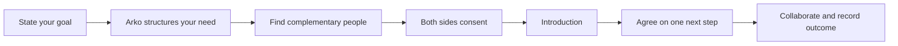
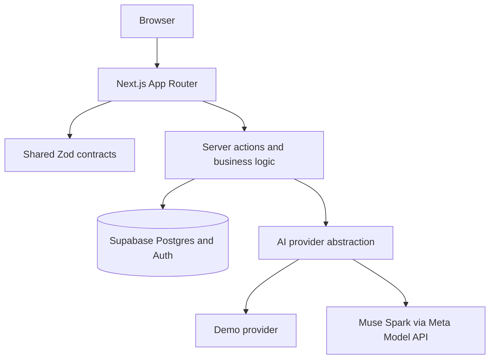

<div align="center">


**Your next career move shouldn't be a solo mission.**

*Tulay* (Tagalog for "bridge") is a community-powered AI agent for career mobility, Philippines first. It helps you state a goal, find real people with complementary needs and offers, exchange introductions with mutual consent, and turn each connection into one concrete collaboration with a recorded outcome. AI assists with language and structure; deterministic code decides matching, consent, and state changes.

[](https://nextjs.org/)
[](https://www.typescriptlang.org/)
[](https://supabase.com/)
[](docs/AI_AGENT_DESIGN.md)
[](#testing)

</div>

---

## Contents

- [Product overview](#product-overview)
- [How it works](#how-it-works)
- [Meet Arko](#meet-arko)
- [Features](#features)
- [Product tour](#product-tour)
- [Architecture](#architecture)
- [Get started](#get-started)
- [Testing](#testing)
- [Security and privacy](#security-and-privacy)
- [Limitations and roadmap](#limitations-and-roadmap)
- [Documentation](#documentation)
- [Background](#background)
- [License](#license)

---

## Product overview

Career mobility runs on people, not just information. Freelancers, career shifters, and founders often know what to do but can't find the right person to do it with — and cold outreach on large platforms feels risky. Tulay's thesis is that AI should help people help one another: it surfaces complementary needs and offers between real members, facilitates introductions only with consent from both sides, and measures success by completed acts of mutual help, not engagement.

Tulay is not a career chatbot, a networking feed, a job board, a mentor directory, or an investor platform. Founder matching runs through the same reciprocal engine as everything else.

### The three pathways

| Pathway | Who it's for | How Tulay helps |
| --- | --- | --- |
| **Change Careers** | Career shifters (for example, BPO to tech, design to product) | Map transferable skills to target roles, meet peers who made the move, get portfolio reviews and interview practice. |
| **Grow as a Freelancer** | Designers, developers, editors, virtual assistants, independents | Find collaborators for skill swaps, get proposal and pricing feedback, trade what you offer for what you need. |
| **Build a Company** | Aspiring founders and early collaborators | Find potential co-founders, early users, domain experts, and mentors through the same needs-and-offers engine. |

### The core journey

Every pathway follows one path: **goal → need → match → consent → introduction → collaboration → outcome**. You state what you're trying to accomplish, Arko helps you articulate one specific need, Tulay finds real people who complement it, both sides agree before any introduction, and you finish with one concrete next step plus a recorded answer to "did this help you move forward?"

---

## How it works



1. **Ask** — Tell Arko about your goal and one specific need. Arko structures it; you confirm before anything is saved.
2. **Match** — Tulay finds real members with complementary needs and offers, and shows when you can help each other.
3. **Introduce** — Send an introduction request with an editable drafted message. The other person must accept or decline; declining is quiet.
4. **Act** — After mutual consent, agree on one concrete next step together.
5. **Follow through** — Complete the step and record whether it helped. Recorded outcomes are the measure of success.

Matching, eligibility, ranking, consent enforcement, and every database state change are deterministic application code. The model never invents people, attributes, or contact details, and nothing reaches another person without explicit approval from both sides.

---

## Meet Arko

<div align="center">

</div>

**Arko** is Tulay's bridge-building companion and the face of **Ask Arko**, the conversational workspace (at `/ask`) where users talk through their next career move. Guests can try the full loop in demo mode; signed-in members get persistence and consent-gated introductions.

### How Ask Arko uses AI

Ask Arko's language understanding and generation run on **Meta Muse Spark** through the Meta Model API, server-side in `services/ai/meta.ts`. The integration uses model `muse-spark-1.3` over Chat Completions with structured JSON outputs: every model response is validated against shared Zod schemas in `packages/shared` before use, and failures throw typed errors that fall back to deterministic paths with visible notes. Voice input is transcribed through the Meta voice transcription endpoint. Demo fallbacks are always labelled in the UI.

### Two different "Muse" names

These are easy to confuse, so Tulay separates them explicitly:

- **Muse Spark (runtime AI, user-facing).** The model integration described above. It runs server-side inside the Next.js app and powers what users see in Ask Arko, Pitch Deck Studio, and voice transcription.
- **Muse Code (development tool, never user-facing).** The coding agent the project team uses to build and maintain Tulay. It runs in the development environment only and ships no code path into the deployed application.

---

## Features

Status labels used below: **LIVE-VERIFIED** (exercised against a live service), **IMPLEMENTED (mock-verified)** (built and covered by tests or mocked verification), **DEMO-ONLY** (works in demo mode only), **PLANNED** (not built or not part of the live set).

### Product surfaces

| Area | Status | Notes |
| --- | --- | --- |
| Guest Ask Arko loop (`/ask`) | DEMO-ONLY | Labelled simulated reply; outcome recorded; guest state stays in the browser. |
| Guided journey (`/start`) | IMPLEMENTED (mock-verified) | Goal-to-need flow feeding matching. |
| Discover, Community, Studios (`/discover`, `/community`, `/studios`) | IMPLEMENTED (mock-verified) | Browse real members; seeded demo members carry a visible Demo label. |
| Email + password auth with 4-step onboarding | LIVE-VERIFIED | Supabase Auth; see `apps/web/app/onboarding/` and `apps/web/proxy.ts`. |
| Dashboard, introductions, collaborations, outcomes (`/home`) | IMPLEMENTED (mock-verified) | Consent-gated; persist to Supabase when signed in. |
| In-app notifications | IMPLEMENTED (mock-verified) | The delivery channel until email is configured. |
| Pitch Deck Studio (`/deck`) | LIVE-VERIFIED | Outline generation live-verified 2026-11-05; you edit every slide; real `.pptx` export. |
| Voice transcription route (`/api/voice/transcribe`) | LIVE-VERIFIED | Route live-verified 2026-11-05; demo fallback is labelled. |
| Live-mic voice end to end | PLANNED | Full microphone-to-reply drive still open. |
| Outbound email (Resend) | PLANNED | Code complete but unconfigured; zero emails sent. See [docs/EMAIL_SETUP.md](docs/EMAIL_SETUP.md). |
| Resume Studio (`/resume`) | PLANNED | In-progress WIP on `wip/resume-studio`; browser-UNVERIFIED; excluded from production. |

### Ask Arko AI operations

| Operation | Status | Notes |
| --- | --- | --- |
| `chat`, `transcribeAudio`, `extractGoal`, `draftDeckOutline` | LIVE-VERIFIED | Recorded against the live API on 2026-11-04/05. |
| `explainMatch`, `draftIntroduction`, `suggestCollaboration`, `suggestTags`, `extractCriteria` | IMPLEMENTED (mock-verified) | Implemented; live calls not yet recorded. |
| `improveResumeSection` | IMPLEMENTED (mock-verified) | Live call not recorded; unreachable from production UI (`/resume` route lives on `wip/resume-studio` only). |

Provider behavior: `getAIProvider()` returns the Meta provider only when `AI_PROVIDER=meta` and a model API key is set; otherwise the deterministic demo provider serves labelled demo output. `/api/health` reports the active provider. Full design and verification notes live in [docs/AI_AGENT_DESIGN.md](docs/AI_AGENT_DESIGN.md).

---

## Product tour

No screenshots or demo video are checked in yet. The fastest tour is local: landing (`/`), guest Ask Arko (`/ask`), guided journey (`/start`), Discover (`/discover`), Community (`/community`), Studios (`/studios`), Pitch Deck Studio (`/deck`), then sign up for the dashboard (`/home`), introductions, collaborations, and outcomes.

<!-- FUTURE SCREENSHOT 1 — Ask Arko (/ask): guest asking about a career move with Arko's structured reply visible. Save under apps/web/public/ and link with a repo-root-relative path. -->
<!-- FUTURE SCREENSHOT 2 — Discover (/discover): reciprocal match card showing "you can help each other". Save under apps/web/public/ and link with a repo-root-relative path. -->
<!-- FUTURE SCREENSHOT 3 — Pitch Deck Studio (/deck): edited outline with .pptx export. Save under apps/web/public/ and link with a repo-root-relative path. -->

---

## Architecture



| Layer | Technology | Notes |
| --- | --- | --- |
| Frontend | Next.js 16, React 19, TypeScript (strict) | `apps/web/` |
| Styling | Tailwind CSS 4 | Utility-first |
| Contracts | Zod | `packages/shared/`, single source of truth |
| AI | Provider abstraction | `services/ai/` — demo and Meta providers |
| Data and auth | Supabase (Postgres + Auth) | Live project; migrations `0001`–`0008`; RLS throughout |
| Tests | Vitest | Repo root; see [Testing](#testing) |

Guiding principles: AI assists, code decides. Schema validation everywhere. Privacy by design through RLS. Demo mode first, always labelled. No invented data. Details: [docs/ARCHITECTURE.md](docs/ARCHITECTURE.md), [docs/TECH_STACK.md](docs/TECH_STACK.md), [docs/DATA_MODEL.md](docs/DATA_MODEL.md).

---

## Get started

### Prerequisites

- Node.js >= 20.9.0
- npm

### Run locally

```bash
git clone https://github.com/OrangeJuice023/tulay.git
cd tulay
npm install
npm run dev
```

Open [http://localhost:3000](http://localhost:3000). Demo mode works out of the box — no sign-up, database, or API keys required. There is no CI or deploy target configured in this repo.

### Environment variables

All optional for demo mode. Names only — see [.env.example](.env.example) for the template and [docs/EMAIL_SETUP.md](docs/EMAIL_SETUP.md) for email.

| Variable | Purpose |
| --- | --- |
| `AI_PROVIDER` | `demo` (default) or `meta`; Meta is used only with a key set |
| `MODEL_API_KEY` | Canonical server-only Meta key |
| `META_MODEL_API_KEY` | Legacy fallback for the Meta key |
| `META_MODEL_API_URL` | Base URL override (has a working default) |
| `META_MODEL_MODEL` | Model override (has a working default) |
| `NEXT_PUBLIC_SUPABASE_URL` | Supabase project URL for auth and persistence |
| `NEXT_PUBLIC_SUPABASE_PUBLISHABLE_KEY` | Browser-safe Supabase key (preferred name) |
| `NEXT_PUBLIC_SUPABASE_ANON_KEY` | Browser-safe Supabase key (legacy name) |
| `SUPABASE_SECRET_KEY` | Server-only Supabase key (preferred name) |
| `SUPABASE_SERVICE_ROLE_KEY` | Server-only Supabase key (legacy name) |
| `RESEND_API_KEY` | Resend key for outbound email |
| `RESEND_FROM_EMAIL` | Verified sender address for outbound email |
| `RESEND_WEBHOOK_SECRET` | Signing secret for delivery webhooks |
| `NEXT_PUBLIC_APP_URL` | Public app URL |

---

## Testing

```bash
npm test          # vitest, repo root
npm run lint      # eslint (web workspace)
npm run typecheck # tsc --noEmit (all workspaces)
npm run build     # production build (web workspace)
```

Status: 379 tests / 32 files, all passing (verified 2026-11-05 on `main`; run `npm test` for the current number).

---

## Security and privacy

1. **Consent first** — nothing reaches another person without explicit approval from both sides.
2. **Real people only** — no invented members, skills, or outcomes; AI only explains or drafts about real candidates.
3. **AI assists, code decides** — matching, eligibility, consent, and database changes are deterministic; model output is Zod-validated.
4. **Demo is labelled** — seeded users are flagged and carry visible Demo labels.
5. **Privacy by design** — RLS on user tables; users see only their own rows and rows they are party to.
6. **No automatic outreach** — every message requires explicit user action.
7. **Server-only secrets** — API keys never reach the client.

See [docs/SECURITY_AND_PRIVACY.md](docs/SECURITY_AND_PRIVACY.md).

---

## Limitations and roadmap

Honest limits of the current state:

- Guest journeys keep introductions and collaborations in browser storage with labelled simulated replies; signed-in members persist to Supabase.
- Live AI verification is partial: four operations recorded live, five mock-verified only, one demo-only. Rate limits, costs, and data-retention terms are unconfirmed.
- No outbound email: Resend is code-complete but unconfigured, so notifications are in-app only.
- Resume Studio is excluded from production (WIP on `wip/resume-studio`, browser-UNVERIFIED).
- Live-mic voice end to end is still open; only the transcription route is live-verified.
- No CI or deploy target is configured; no license has been chosen yet.

Roadmap:

- [ ] Finish Muse Spark verification (remaining operations, rate limits, costs, data retention)
- [ ] Verify Resume Studio and record its migration
- [ ] Drive live-mic voice end to end
- [ ] Configure outbound email or document the decision not to
- [ ] Add product screenshots and an Ask Arko demo clip
- [ ] Choose a license
- [ ] Native mobile via Expo, reusing the shared contracts

---

## Documentation

- [AGENTS.md](AGENTS.md) — canonical agent instructions
- [docs/PROJECT_DIRECTION.md](docs/PROJECT_DIRECTION.md) — north star (canonical)
- [docs/PRODUCT_SPEC.md](docs/PRODUCT_SPEC.md) — MVP requirements
- [docs/ARCHITECTURE.md](docs/ARCHITECTURE.md) — architecture
- [docs/TECH_STACK.md](docs/TECH_STACK.md) — tech stack
- [docs/AI_AGENT_DESIGN.md](docs/AI_AGENT_DESIGN.md) — AI design, Muse Spark, validation
- [docs/DATA_MODEL.md](docs/DATA_MODEL.md) — data model
- [docs/SECURITY_AND_PRIVACY.md](docs/SECURITY_AND_PRIVACY.md) — security and privacy
- [docs/brand/](docs/brand/) — brand assets
- [planning/](planning/) — checklist, issues, next steps
- [research/](research/) — research

---

## Background

Tulay was built for the Meta Global AI Developer Hackathon (Oct 26 – Nov 4, 2026) on a simple bet: one polished end-to-end flow beats many half-built features. Career data is curated and labelled, all demo members are synthetic, and Arko is Tulay's bridge-building mascot.

---

## License

Not yet chosen — this repo has no `LICENSE` file, so there is no license badge above. Until a license is added, all rights reserved by default.
