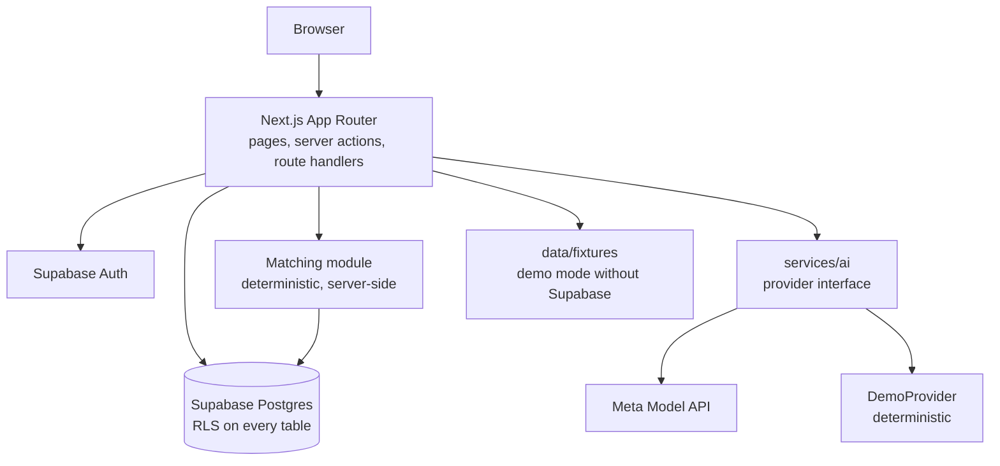

# Architecture

Status: the boundaries below are the target. As of 2026-10-28 only static pages exist; nothing
talks to Supabase or a model yet. Product direction is canonical in `docs/PROJECT_DIRECTION.md`:
every component below exists to turn introductions into completed acts of mutual help.

## Components

One deployable: the Next.js app. No separate API server.

## Boundaries

| Module | Responsibility | Must not |
| --- | --- | --- |
| `apps/web` | UI, routes, server actions, auth session | Import the service-role key or model key into client components |
| `packages/shared` | Zod schemas and types: the contract between UI, server and AI | Contain I/O |
| Matching (`packages/shared/matching.ts`, decided 2026-10-28) | Given a need, return eligible real candidates with the factors that matched | Call the model |
| `services/ai` | Prompting, calling the model, validating output, demo provider | Write to the database or pick candidates |
| `supabase/` | Migrations, RLS policies, demo seed | Hold real user data |

## Data flows

1. **Goal → need.** User types a goal. Server action calls `extractGoal` (model or demo). Output
   is validated with `ExtractedGoalSchema`; the user confirms or edits it before it is saved.
2. **Need → candidates.** Server queries offers whose tags overlap the need, excluding the user,
   inactive members and people who opted out of discovery. Deterministic ranking.
3. **Candidates → explanation.** For each returned candidate only, `explainMatch` writes a
   one-paragraph reason using only fields that candidate made visible. Validated; on failure show
   the deterministic matched factors instead.
4. **Introduction.** User edits a model-drafted message and sends a request. The recipient sees
   it in-app and accepts or declines. Contact details are shared only after acceptance.
5. **Collaboration.** On acceptance a collaboration is created with one agreed next step.
   Either party updates status; each records whether it helped.

## Trust boundaries

- **Browser:** sees only the anon key and rows RLS allows.
- **Server:** checks the session on every mutation; consent state changes only through explicit
  user actions, never from model output.
- **Model:** receives the minimum fields needed, never contact details; output is untrusted.
- **Database:** RLS is the last line of defence, not the only one.

## Deployment

Target: Vercel (web) + Supabase hosted (auth, DB). Secrets in Vercel environment variables.
Not set up yet.

## International readiness

Keep `country_code` (ISO 3166-1 alpha-2), `currency_code` (ISO 4217) and `locale` on the
relevant rows from the start (see `docs/DATA_MODEL.md`), default to `PH` / `PHP` / `en-PH`.
Do not build multi-country ingestion or UI until the MVP works.
