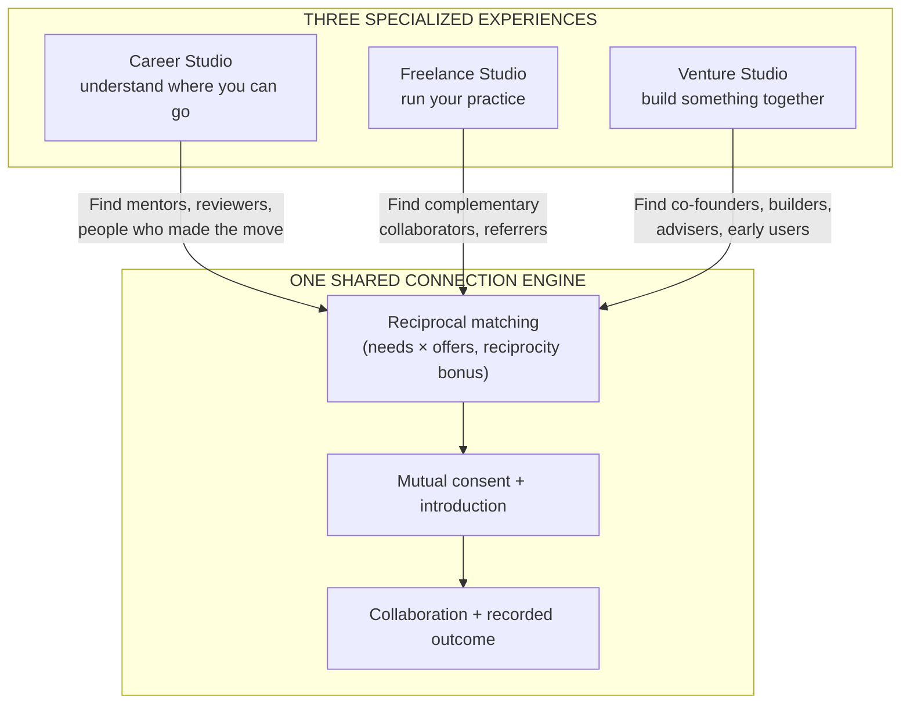

# Tulay Product Architecture: three studios, one connection engine

Status: proposal for review. No code changes.

## North star (unchanged)

"Your next career move shouldn't be a solo mission."

## The architecture

Studios are specialized dashboards, tools, and progress. They are **not**
three matching funnels with different paint. Each studio helps the user
understand what they need; the engine finds people who can help; every pathway
ends in collaboration and a recorded outcome. Matching stays primary — it is
the differentiator — but users may explore, research, and plan freely before
they ever meet a candidate.

## What exists today (verified in this repo)

- **Engine (implemented):** `packages/shared` (Zod contracts, deterministic
  matching with tag + keyword scoring, concierge one-at-a-time lifecycle,
  8-role curated career map), `services/ai` (provider interface, deterministic
  demo provider, Meta provider shape), consent/introduction/collaboration/
  outcome flow in `apps/web/app/start`, browser-local persistence, 14
  synthetic labeled members.
- **Studio-like surfaces (thin):** three intake variants in one journey,
  career-mapping panel (Career Studio seed), nothing freelance- or
  founder-specific.
- **Brand:** palette, type, logo, Arko mascot, voice rules in `docs/brand/`.

## What is new vs adapted

| Area | Status |
| --- | --- |
| Connection engine (match, consent, collaborate, outcome) | Exists — reuse untouched |
| Studio dashboards, tools, progress | New (thin slices first) |
| Career intelligence data | Exists (8 roles) — extend, never bulk-import Landas |
| Landas Simulator/Map/Explore patterns | Adapt interaction design only; no Supabase, no jobs proxy, no salaries |
| Stories from recorded outcomes | New presentation over existing data |
| Expo app | Does not exist — after web IA stabilizes |

## Decision: web first, engine frozen

1. Freeze the engine's contracts (`Need`, `Offer`, `IntroductionRequest`,
   `Collaboration`, concierge states). Studios compose it; they don't fork it.
2. Build the IA shell and Career Studio first (strongest existing foundation).
3. Freelance and Venture MVPs reusing the same engine calls.
4. Stories generated from recorded outcomes.
5. Expo shell only once the IA and contracts stop moving.

Details: `02-information-architecture.md` through `10-implementation-sequence.md`.
Priorities: `09-prioritization-matrix.md`.
