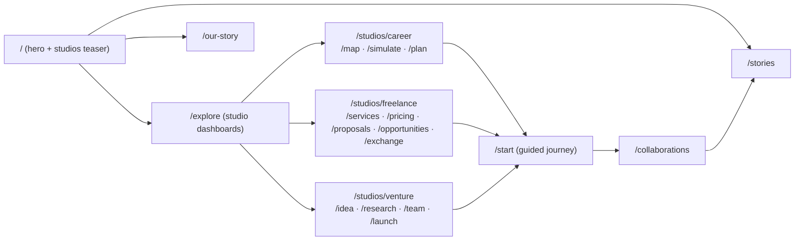

# Information Architecture and Route Map

Status: proposal for review. No code changes.

## Principles (from `ui-ux-pro-max` priorities)

- One primary task per screen; predictable back; deep links to every studio
  tool (`/studios/<studio>/<tool>`).
- People discovery is contextual inside each studio; collaboration surfaces
  (`/collaborations`, consent, outcome) are shared and identical everywhere.
- Mobile and desktop share one IA: header on desktop, the same links in a
  compact menu on phones; studio tools are thumb-reachable cards, never hover-only.

## Proposed navigation

Header: **Explore · Stories · Our Story · My Collaborations · [Get Started]**.
`Explore` replaces the current single-funnel start as the front door; `Get
Started` keeps the existing guided journey (`/start`) working for judges and
returning users.

## Route map

- `/demo`, `/onboarding`, `/find-help` keep redirecting to `/start` (unchanged).
- `/profile` stays a placeholder until sign-in exists (unchanged).
- `/api/health` unchanged (provider/mode reporting).

## Screen hierarchy per studio

Each studio dashboard answers three questions above the fold: *where am I, what
can I do here, who can I meet next?* Below: the studio's tools as cards, a
progress strip (plan items done, proposals sent, milestones hit), and one
contextual people entry ("Meet people who fit this direction").

## Shared services and components (already exist, reuse)

`packages/shared` (contracts, matching, concierge, career-map), `services/ai`
(provider + Zod-validated outputs), `Arko`, `MatchCard`, `Notice`/`DemoBadge`
provenance labels, `EmptyState`/`LoadingState`, localStorage stores. New studio
UI must compose these, not duplicate them.

## Mobile behavior

Studio dashboards are single-column card stacks; tools open full-screen;
consent and outcome keep the existing pinned ActionBar (never inside a
transformed ancestor). No separate mobile IA — the same routes, responsive.
