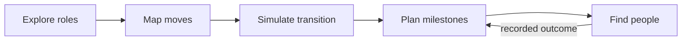

# Career Studio specification

Status: proposal for review. Extends the existing `career-map.ts` + `mapCareerAction`
foundation. No code changes in this phase.

## What Landas actually implements (inspected, not screenshots)

- **Explore** (`ExploreView`): free-text analyzer + current-role/industry
  inputs, deterministic candidate roles, AI narrative via Supabase edge
  function, labor context from a **static ingested PSA snapshot** (`labor.ts`
  loads `openstat.json`; scope rules forbid presenting industry pay as role
  pay or old rounds as live demand).
- **Simulator** (`SimulatorView`): current/target role + have/plan skills →
  `simulateTransitions` ranked options, per-option shared/gap skills, AI
  explanation, save to Supabase `saved_paths` (anon sessions, RLS).
- **Career Map** (`CareerMapView`): focus role + related roles
  (`career-ladder` / `same-department` / `skill-overlap`), skill-highlighted
  connectors (DOM-measured, wide screens only), trail history.
- **My Paths / Profile**: Supabase-persisted paths, milestones,
  achievements, share cards. **Do not import** — Tulay has no backend yet.
- **Jobs** (`jobsClient` → `jobs-proxy` edge function): graceful
  `unavailable`, never fabricated. Tulay equivalent: none (no job board, per
  scope rules).

## Proposed Career Studio tools (Tulay routes)

### 1. Explore Industries — `/studios/career` (P0)

Browse industry → department → role → skills + typical progression, all from
the curated catalog. Exclude employer names (Landas seed has them; Tulay
skips them for privacy/scope). Each role card ends in two actions: "Simulate
a move here" and "Find people who know this role".

### 2. Career Map — `/studios/career/map` (P0)

Adapt Landas's relation model (ladder / same-field / shared-skills with
stated basis) onto the curated catalog. Same interaction grammar: focus role,
up to 6 related moves, click a skill to see which moves share it. Connectors
decorative, DOM-measured, wide-screens only (same approach as Landas).

### 3. Career Simulator — `/studios/career/simulate` (P0)

Adapt `SimulationDraft`: current role (optional), target, have-skills,
plan-skills → ranked options with shared vs to-develop lists. Deterministic
only. AI narrative via the existing provider, labeled `demo-template`/`live`.
**Hard rules:** no probabilities, no salaries, no guaranteed outcomes, no
"verified gaps" language — "potential development areas" only.

### 4. Transition Planner — `/studios/career/plan` (P0)

Planned skills become checkable milestones (localStorage), each with a "find
people who know X" deep link that pre-fills the matcher with that skill as
context. Progress strip feeds the studio dashboard.

### 5. Find People (P0, exists)

The current one-at-a-time browsing + `careerDirection` enrichment. No
changes except entry points from the four tools above.

## Provenance (extends ADR-0002)

`curated` (catalog facts) · `user-provided` (typed) → `user-confirmed`
(checked) · `ai-generated` (labeled, never auto-verified) · `source-backed`
reserved for genuinely sourced data (PSA-style datasets are P2 and stay out
of the MVP).

