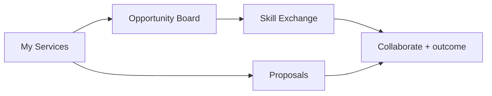

# Freelance Studio specification

Status: proposal for review. Distinct dashboard and workflow; engine reuse
only. No code changes in this phase.

## Why it must differ

Today "Grow as a freelancer" renders the same intake → matches funnel as the
other paths. Freelancers don't need a career direction — they need clients,
pricing confidence, proposals, and a bench of complementary collaborators.

## Proposed tools (Tulay routes)

### 1. My Services — `/studios/freelance/services` (P0)

Skills, services, and offers as structured records (extends `Offer` usage:
title, description, tags, status). Stored locally. This is the inventory
everything else draws on — and the reciprocal side of matching.

### 2. Proposal Studio — `/studios/freelance/proposals` (P0)

Draft-and-improve loop mirroring the existing introduction-draft flow: pick a
service + a need (yours or a posted opportunity), provider drafts, you edit,
labeled `demo-template`/`live`. Reuses the AI-orchestration pattern, new
Zod contract.

### 3. Opportunity Board — `/studios/freelance/opportunities` (P0)

Project opportunities and collaboration requests as a readable board. Seeds
from fixture `Need`s (real community data, labeled synthetic) plus the
visitor's own posted needs. **Not a job board**: no applications, no
payments — every card resolves to "request an introduction" (existing flow).

### 4. Skill Exchange — `/studios/freelance/exchange` (P0, exists adapted)

Reciprocal matching filtered to service tags (e.g. designer seeks developer
and offers design). Same engine, same one-at-a-time browsing, same consent.

### 5. Pricing Lab — `/studios/freelance/pricing` (P1)

Pricing assumptions and package builder (service + scope + price band as
structured, user-owned data). AI may sanity-check wording, never set prices.
No market-rate claims without sourced data (none in MVP).

### 6. Find Collaborators (P0, exists)

Complementary-professional browsing with a freelancer lens (referral
partners, portfolio reviewers). Existing flow, new entry copy.

## Dashboard progress

Services listed · proposals sent · exchanges completed (given/received from
recorded outcomes) · active opportunities. All derivable from existing
contracts + localStorage; no backend required.

