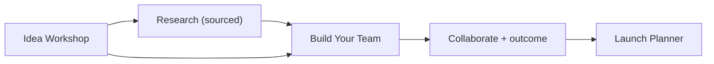

# Venture Studio specification

Status: proposal for review. Distinct founder workflow ending at team, not at
content. No code changes in this phase.

## Research capability audit (honest)

Tulay's app today has **no live web browsing**: `MetaModelProvider` makes
chat-completion calls only. My session's web-search tooling is agent
infrastructure, not app capability. Therefore:

- **P1:** research from **user-provided sources** — paste a URL + optional
  notes; the provider extracts structured claims; every claim keeps
  `{ sourceUrl, retrievedAt, quote }`, and AI interpretation is labeled
  separately from source evidence.
- **P2 / external:** live public-web retrieval needs a new approved
  integration (search API + fetch + quote extraction). Not designed here.

All research rules from the brief hold at every tier: public sources only,
URLs + dates preserved, evidence vs interpretation separated, no contact
harvesting, no automated outreach, no "validated because the AI liked it".

## Proposed tools (Tulay routes)

### 1. Idea Workshop — `/studios/venture/idea` (P0)

Structured idea capture (problem, customer, solution, unfair edge — new Zod
contract, localStorage). One screen, plain language, Arko-curious optional.

### 2. Problem & Customer — `/studios/venture/research` (P1)

Problem statement + customer definition worksheets feeding the team matcher
("who talks to these customers daily?").

### 3. Market & Competitor Research (P1, user-sourced)

Source cards (URL, date, quoted evidence, AI summary labeled as such).
Competitor table: name, what they do, evidence link — no scraped private data.

### 4. Customer Discovery (P1)

Interview script builder (AI-assisted questions from the idea contract) +
note capture. Notes are `user-provided`, never auto-findings.

### 5. Opportunity Analysis (P1)

Simple worksheet scoring problem pain, reach, and founder fit — user-scored,
deterministic, no pseudo-probabilities.

### 6. Build Your Team — `/studios/venture/team` (P0)

Role-based needs (technical co-founder, designer, adviser, early users) mapped
to the existing matcher: each role becomes a `Need` with role-flavored tags,
browsed one at a time, same consent. **This is the studio's conversion point
and must not be an afterthought.**

### 7. Launch Planner — `/studios/venture/launch` (P1)

Milestone checklist (idea → first users → first collaboration) with progress,
localStorage, deep links back to team-finding per milestone.

