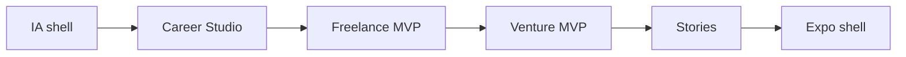

# Implementation sequence: web first, then Expo

Status: proposal for review. Assumes the P0 column of
`09-prioritization-matrix.md`.

## Recommended order (and why)

1. **IA shell** (`/explore`, three studio dashboards, `/stories`,
   `/our-story` routes with real content structure). Why first: every later
   slice needs a home; thin pages prove the navigation before tools exist.
2. **Career Studio tools** (Explore → Map → Simulate → Plan). Why second:
   strongest foundation — engine + 8-role catalog + `mapCareerAction` already
   exist; this is adaptation, not invention.
3. **Freelance MVP** (Services → Board/Exchange → Proposals). Why third:
   mostly new forms over proven engine calls; validates the "shared engine,
   distinct studio" thesis.
4. **Venture MVP** (Idea → Team). Why fourth: smallest new surface that still
   proves the founder path converts to people-finding.
5. **Stories from outcomes** (render recorded collaborations as labeled demo
   stories). Why last on web: needs real journey completions to show.
6. **Expo shell.** Why last: no app exists; contracts must stop moving
   first. Reuse `@tulay/shared` + provider interface verbatim; Studio screens
   are new React Native UI over the same engine calls. Do not start before
   (1)–(4) are stable.

## Gates per phase

Typecheck + lint + 160-test suite green; production build green; new strings
confirmed in build output; no secrets; no commits without review. The engine
contracts stay frozen throughout — studios that need new fields propose a
contract ADR first.
